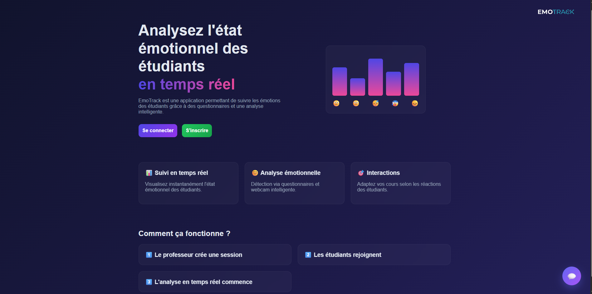
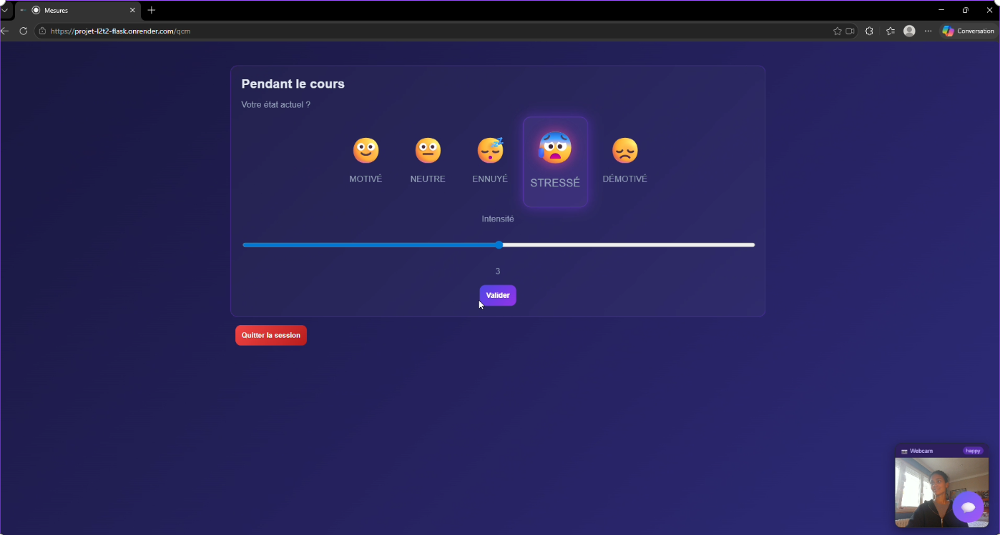
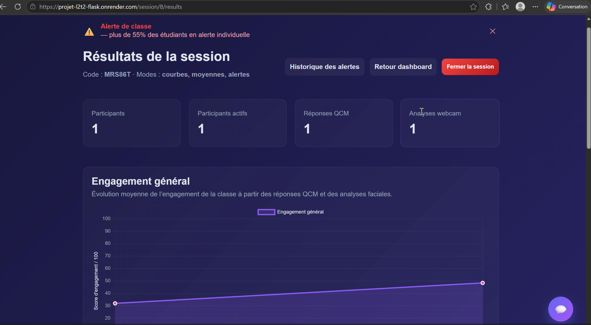
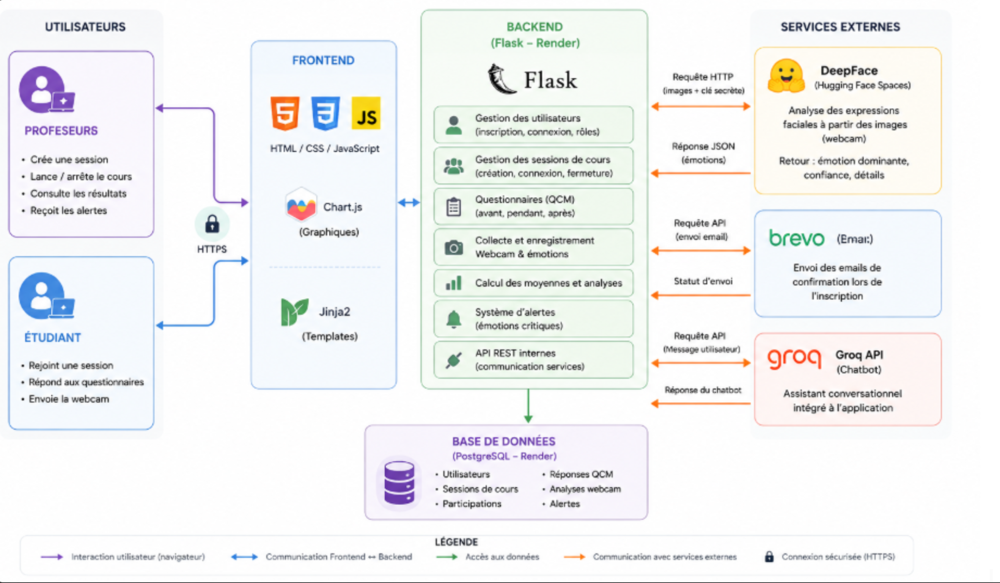

# EmoTrack

> Application web de suivi émotionnel en temps réel pour les cours en ligne.


---

## 1. Description

EmoTrack est une application web qui mesure subjectivement et objectivement les émotions des étudiants lors d'un cours en ligne. Elle a été conçue et développée dans le cadre d'un projet de L2 Informatique et Applications à l'Université Paris Cité, par quatre étudiants, sous la direction de M. Gnaho.

L'objectif est de reconstruire la communication non-verbale entre le professeur et son audience lors d'un cours en ligne, en se concentrant sur les émotions ressenties par les étudiants. EmoTrack combine deux types de mesure complémentaires :

- **Mesure subjective** — l'étudiant évalue lui-même son état émotionnel via un emoji et une échelle de Likert, sans interrompre le cours.
- **Mesure objective** — l'état émotionnel est capturé automatiquement via l'analyse faciale de la webcam, grâce à la bibliothèque DeepFace.

> Le service DeepFace est déployé séparément sur Hugging Face Spaces. Voir le dépôt dédié : [EmoTrack — Serveur DeepFace](#)

---

## 2. Aperçu




---

## 3. Fonctionnalités principales

### Côté professeur
- Créer une session avec des paramètres personnalisables : fréquence des QCM, fréquence de l'analyse webcam
- Choisir le mode d'affichage des résultats :
  - **Mode moyennes** — tendances globales de la classe et résultats individuels
  - **Mode courbes** — graphiques d'évolution et donuts par type de mesure
  - **Mode alerte** — notification lorsque la classe ou un individu dépasse un seuil d'émotions négatives
- Visualiser les résultats en temps réel pendant la session
- Exporter un rapport de session

### Côté étudiant
- Rejoindre une session via un code à 6 caractères fourni par le professeur
- Choisir d'être anonyme ou non
- Activer ou non sa webcam pour la mesure objective
- Répondre aux QCM émotionnels pendant la session

---

## 4. Stack technique



| Composant | Technologies |
|---|---|
| Backend | Python, Flask, SQLAlchemy |
| Base de données | PostgreSQL, SQLite |
| Frontend | HTML, CSS, JavaScript, Chart.js, Jinja2 |
| Analyse émotionnelle | DeepFace via Hugging Face Spaces |
| Emails | Brevo |
| Déploiement | Render |
| Tests | Pytest |

---

## 5. Installation et lancement en local

### Prérequis
- Python 3.10+
- pip
- Un compte Brevo (pour les emails de confirmation)

### Étapes

**1. Cloner le dépôt**
```bash
git clone https://github.com/[votre-repo]/emotrack.git
cd emotrack
```

**2. Installer les dépendances**
```bash
pip install -r requirements.txt
```

**3. Configurer les variables d'environnement**

Créer un fichier `.env` à la racine du projet :
```env
SECRET_KEY=votre_clé_secrète
DATABASE_URL=sqlite:///emotrack.db
BREVO_API_KEY=votre_clé_brevo
DEEPFACE_SECRET_KEY=votre_clé_deepface
DEEPFACE_URL=url_de_votre_space_huggingface
```

**4. Lancer l'application**
```bash
flask run
```

L'application est accessible à l'adresse : http://localhost:5000

---

## 6. Structure du projet

```
emotrack/
├── app.py              # Point d'entrée Flask
├── templates/          # Fichiers HTML (Jinja2)
├── static/             # CSS, JS, images
├── models/             # Modèles SQLAlchemy
├── tests/              # Tests Pytest
└── requirements.txt    # Dépendances Python
```

---

## 7. Contexte technique

### Mesure objective — DeepFace
La mesure objective s'appuie sur DeepFace, une bibliothèque Python open source utilisant des modèles pré-entraînés (dont OpenFace) pour analyser les expressions faciales en temps réel. Elle détecte les sept émotions de base : joie, tristesse, colère, surprise, peur, dégoût et neutralité.

### Mesure subjective — QCM émotionnel
La mesure subjective repose sur l'auto-évaluation. Elle combine une sélection visuelle par emoji (inspirée des Mood Trackers) et une échelle de Likert numérique, permettant à l'étudiant d'exprimer son état émotionnel en quelques secondes sans interrompre le cours.

---

## 8. Auteurs

Projet réalisé dans le cadre du L2 Informatique et Applications — Université Paris Cité (2025-2026)  
Encadrant : M. Gnaho

- Lisa Swiatek-Hugon
- Gabrielle David
- William Ourfahli
- Aymen Herda
